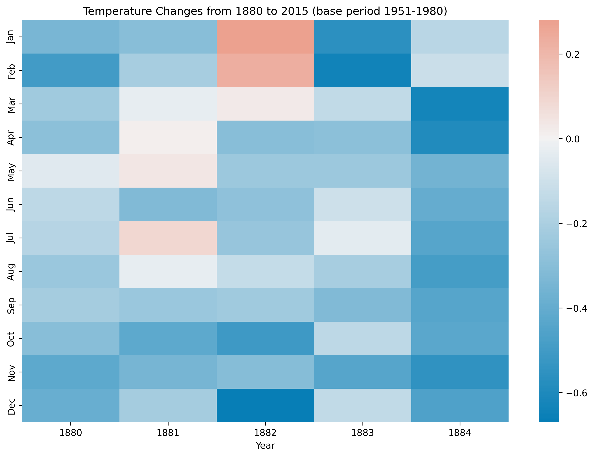

# Wang Paner — Data Science Portfolio

## About Me
I am a student in CISC7204 learning data science with Python.
I enjoy working with real-world datasets and turning them into
clear visual stories.

## Technical Skills
- Python
- pandas, numpy
- matplotlib, seaborn
- Jupyter Notebook

## Project Showcase

### Northern Hemisphere Surface Temperature Change (1880–2015)
**Research question:** How has the surface temperature in the Northern
Hemisphere changed from 1880 to 2015, and which months show the
strongest warming?

**Findings:** Temperature anomalies show a clear upward trend from
1880 to 2015, with stronger warming after 1980, especially in winter
months.

**Repository:** [data-science-project](https://github.com/wangpaner14-bit/data-science-project)

**Status:** Completed
